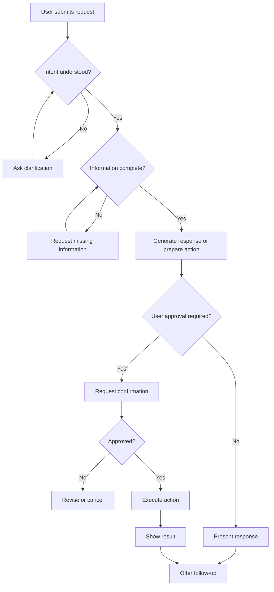

# Conversational UX Design

## 1. Introduction

Conversational UX design focuses on creating effective interactions between users and products through natural language.

Unlike traditional graphical interfaces, where users primarily interact with buttons, menus, forms, and navigation elements, conversational interfaces allow users to express their intentions through text or speech.

AI-powered conversational products introduce additional possibilities. Users can ask questions, provide context, refine requests, explore ideas, and complete tasks through multiple turns of interaction.

Examples include:

- AI chat assistants
- Customer support chatbots
- AI writing assistants
- Educational AI tutors
- Voice assistants
- AI-powered search interfaces
- Conversational shopping assistants

However, natural language interaction does not automatically create a good user experience.

Users may not know what to ask, conversations may become lengthy, the AI may misunderstand intent, and important information may be lost across multiple turns.

Effective conversational UX design makes these interactions understandable, efficient, predictable, and recoverable.

## 2. Understanding Conversational Interfaces

A conversational interface allows users to interact with a digital system through dialogue.

The interface typically includes three components:

1. User input: The user submits a question, instruction, or response.
2. System interpretation: The system processes the input and determines an appropriate response or action.
3. System output: The system presents information, asks a question, or performs an action.

AI-powered conversational interfaces can support more flexible language than traditional rule-based chatbots. They can often interpret varied expressions and generate context-sensitive responses.

However, they may also produce inconsistent answers or misunderstand ambiguous requests.

### 2.1 Types of Conversational Interfaces

| Type | Interaction characteristics | Typical use cases |
|---|---|---|
| Rule-based chatbot | Uses predefined rules and dialogue paths | FAQs and structured support |
| Intent-based chatbot | Identifies predefined user intents | Customer service workflows |
| AI chatbot | Generates responses using language models | General assistance and information retrieval |
| Task-oriented assistant | Helps users complete specific tasks | Booking, ordering, and account management |
| Voice assistant | Uses spoken input and audio output | Hands-free assistance |
| AI agent interface | Supports conversations alongside multi-step actions | Research and workflow automation |

These categories can overlap. For example, a task-oriented assistant may combine predefined workflows with an LLM to understand natural language.

### 2.2 Conversational UX vs. Traditional GUI

Conversational interfaces and graphical user interfaces solve interaction problems in different ways.

| Dimension | Traditional GUI | Conversational interface |
|---|---|---|
| Input | Buttons, forms, menus | Text or speech |
| Navigation | Explicit interface structure | Dialogue and contextual prompts |
| User guidance | Labels and visual controls | Instructions and suggested questions |
| Error handling | Validation messages | Clarification and conversational recovery |
| Context | Often represented by interface state | May be maintained across dialogue turns |
| Discoverability | Visible navigation options | Requires examples and capability guidance |
| Interaction speed | Efficient for structured tasks | Flexible for complex or open-ended requests |

Conversational interfaces are not always better than graphical interfaces.

For tasks involving precise selection, comparison, or structured data entry, conventional controls may be more efficient.

A strong AI product often combines conversational interaction with graphical elements such as forms, cards, tables, buttons, and confirmation dialogs.

## 3. Core Principles of Conversational UX Design

### 3.1 Make the First Interaction Easy

Users should understand how to begin a conversation.

An empty chat interface can create uncertainty because users may not know what the AI can do or how to phrase a request.

Useful design elements include:

- A clear introduction explaining the assistant's purpose.
- Example prompts showing common tasks.
- Suggested questions based on the product's capabilities.
- A visible input field.
- Clear instructions for supported input types.

For example, an AI learning assistant might display:

- Explain a mathematics concept.
- Give me a hint for this problem.
- Generate five practice questions.
- Explain why my answer is incorrect.

Examples should represent real product capabilities rather than create unrealistic expectations.

### 3.2 Keep Conversations Focused

A good conversational interface helps users accomplish their goals without unnecessary dialogue.

Avoid:

- Repeating information already provided.
- Asking multiple unnecessary questions.
- Adding unrelated explanations.
- Generating excessively long responses.
- Requiring users to restate the same context.

The system should ask focused clarification questions when essential information is missing.

### 3.3 Maintain Conversational Context

Users expect an AI assistant to understand references to earlier messages.

For example:

**User:** Explain photosynthesis.

**AI:** Photosynthesis is the process by which plants convert light energy into chemical energy.

**User:** Make it simpler.

**AI:** Plants use sunlight to make their own food.

The second request depends on the previous response. The system should interpret it as a request to simplify the explanation rather than treat it as an unrelated instruction.

### 3.4 Make System Behavior Predictable

Users should understand what happens after submitting a message.

Useful interaction feedback includes:

- Message submission confirmation.
- Processing indicators.
- Streaming response feedback.
- Tool execution status.
- Error messages.
- Completion notifications.

The interface should distinguish between generating an answer and executing an external action.

For example, displaying "Preparing your email" is different from displaying "Email sent." The latter should only appear after successful execution.

### 3.5 Preserve User Control

Users should be able to manage the conversation and its results.

Useful controls include:

- Edit prompt
- Regenerate response
- Stop generation
- Copy response
- Clear conversation
- Start a new conversation
- Provide feedback
- Undo or reverse supported actions

Controls should be available when relevant without overwhelming the interface.

## 4. Designing Conversation Flows

A conversation flow describes how users and the AI system move through an interaction to accomplish a task.

Even when an LLM generates responses dynamically, the product should define the intended interaction structure.

### 4.1 Identify the Conversation Goal

Start by identifying what the user wants to accomplish.

Common conversation goals include:

- Obtaining information.
- Learning a concept.
- Creating content.
- Solving a problem.
- Making a decision.
- Completing a transaction.
- Managing a workflow.

The goal determines what information the system needs and what actions it should support.

### 4.2 Define the Main Conversation Stages

A task-oriented AI conversation can follow a general structure:

1. Initiation: The user starts the conversation.
2. Intent understanding: The system identifies the user's goal.
3. Information gathering: The system requests missing information.
4. Response or action: The system provides an answer or performs an authorized task.
5. Confirmation: The system verifies whether the result meets the user's needs.
6. Follow-up: The user continues, modifies, or completes the task.

Not every conversation requires every stage.

For example, a simple factual question may only require initiation, response, and follow-up.

### 4.3 Design for Different Conversation Paths

A conversation flow should account for more than the ideal interaction.

Consider an AI appointment assistant.

**Primary flow:**

1. User requests an appointment.
2. AI asks for the preferred date.
3. User provides a date.
4. AI checks available slots.
5. AI presents available options.
6. User selects a slot.
7. AI requests confirmation.
8. AI completes the booking.
9. AI displays the booking result.

**Alternative paths:**

- The requested date is unavailable.
- The user changes the preferred time.
- Required information is missing.
- The user cancels the request.
- The booking service is unavailable.
- The user asks an unrelated question.

Planning alternative paths prevents the interface from becoming unusable when a conversation does not follow the expected sequence.

### 4.4 Use Conversation Flow Diagrams

A flow diagram helps product designers, UX designers, and developers understand the interaction structure.

Example:

The diagram represents a general task-oriented workflow. Actual conversation paths should be adapted to the product and its risk level.

## 5. Managing Conversation Context

Context management is one of the most important aspects of conversational AI UX.

Users expect the system to remember relevant information within a conversation, but they also need to understand when context may be incomplete or unavailable.

### 5.1 Types of Conversational Context

A conversational system may use several types of context.

| Context type | Description | Example |
|---|---|---|
| Current message | Information in the latest user input | "Make it shorter." |
| Conversation history | Previous messages in the current session | Earlier discussion about a topic |
| Task context | Information needed to complete the current task | Selected date and appointment type |
| User preferences | Relevant preferences retained by the product | Preferred response language |
| External context | Information retrieved from connected sources | Current product documentation |

These context types may have different storage, privacy, and retention requirements.

The interface should not imply that information is remembered permanently when it is only available within the current session.

### 5.2 Support Context References

Users frequently refer to earlier content using expressions such as:

- Make that shorter.
- Explain the second point.
- Use the previous example.
- Compare these two options.
- Continue from where we stopped.

The system should resolve these references using relevant conversation history.

When multiple interpretations are possible, it should ask a focused clarification question.

### 5.3 Prevent Context Confusion

Long conversations may contain several topics or changing requirements.

Potential problems include:

- The AI refers to outdated information.
- The AI mixes details from different tasks.
- The AI forgets important constraints.
- The AI interprets a new request using irrelevant earlier context.

Design approaches include:

- Displaying the current task or selected item.
- Allowing users to start a new conversation.
- Providing ways to correct or update important context.
- Summarizing long-running tasks.
- Confirming critical details before execution.

### 5.4 Make Context Visible When Necessary

Users do not need to see every internal detail of context processing.

However, important context should be visible when it affects the result.

For example:

"Using your selected product model: Router X."

Or:

"I'll use the document you uploaded in this conversation."

Visible context reduces misunderstandings and gives users an opportunity to correct incorrect assumptions.

## 6. Designing Conversational Inputs

The input area is a central part of the conversational interface.

Its design should make it easy for users to communicate their intent.

### 6.1 Text Input

A text input should:

- Support natural sentence-length requests.
- Allow multiline messages when appropriate.
- Provide a clear send action.
- Support keyboard submission.
- Preserve text when submission fails.
- Make input restrictions visible.

Avoid overly restrictive input fields that prevent users from expressing complex requests.

### 6.2 Suggested Prompts

Suggested prompts help users understand what the AI can do.

They are especially useful during onboarding and when users have completed a task.

Examples:

- Summarize this document.
- Explain this concept with an example.
- Compare the available options.
- Generate a practice exercise.

Suggested prompts should be contextual and relevant to the current product state.

### 6.3 Attachments and Multimodal Input

Some AI products support images, documents, audio, or other input types.

The interface should communicate:

- Which file formats are supported.
- Maximum file sizes.
- Whether multiple files can be uploaded.
- Whether files are being processed.
- Whether the system successfully received the content.
- How uploaded content is handled.

When processing fails, provide a useful explanation and an alternative action.

### 6.4 Voice Input

Voice interfaces introduce additional interaction requirements.

Important considerations include:

- Microphone permission.
- Recording status.
- Speech recognition feedback.
- Background noise handling.
- Editable transcription.
- Playback controls.
- Clear indicators when the system is listening or speaking.

Users should be able to correct speech recognition errors before submitting important instructions.

## 7. Designing Conversational Outputs

AI responses should be easy to scan, understand, and act upon.

A conversational interface should not display every response as an unstructured block of text.

### 7.1 Use Clear Response Structures

Depending on the task, responses may include:

- Short paragraphs.
- Headings.
- Numbered steps.
- Bullet lists.
- Tables.
- Code blocks.
- Citations or source links.
- Interactive controls.

For example, a troubleshooting assistant should present actionable steps in sequence rather than provide a long paragraph containing multiple instructions.

### 7.2 Match Response Length to User Intent

The response should provide enough information to satisfy the request without unnecessary detail.

Consider these patterns:

| User intent | Recommended response |
|---|---|
| Quick factual question | Short direct answer |
| Concept explanation | Structured explanation with examples |
| Step-by-step task | Numbered instructions |
| Comparison | Table with relevant criteria |
| Complex analysis | Summary followed by detailed sections |
| Troubleshooting | Diagnostic questions and actionable steps |

### 7.3 Distinguish Answers from Actions

A conversational assistant may provide information or execute operations.

The interface should make the distinction clear.

For example:

- "Here is a suggested reply." indicates generated content.
- "Your reply has been sent." indicates a completed action.

For external operations, the system should communicate whether an action is proposed, awaiting approval, in progress, completed, or failed.

### 7.4 Provide Supporting Evidence

When an answer depends on external information, users may need to inspect its sources.

Useful elements include:

- Source titles.
- Direct links.
- Relevant quotations.
- Retrieval timestamps when freshness matters.
- Clear distinctions between retrieved information and AI-generated interpretation.

The amount of evidence should match the importance and verifiability requirements of the task.

## 8. Handling Conversation Errors and Recovery

Conversational systems must support imperfect inputs and unexpected outcomes.

Error recovery should help users continue without unnecessary repetition.

### 8.1 Ambiguous Requests

When the user's intention is unclear, ask a focused question.

Example:

**User:** Find a suitable option.

**AI:** What type of option are you looking for?

Avoid generating a long list of assumptions when a short clarification would resolve the ambiguity.

### 8.2 Missing Information

If required information is missing, identify exactly what is needed.

Example:

"Which date would you prefer for the appointment?"

Do not ask users to provide information that is already available in the current conversation or product context.

### 8.3 Unsupported Requests

When the system cannot perform a requested task:

1. Explain the limitation.
2. Avoid implying that the action was completed.
3. Suggest a supported alternative.
4. Preserve relevant user input when possible.

### 8.4 Failed Tool Execution

AI assistants may depend on external tools and services.

For example, a calendar assistant may fail to retrieve available time slots.

The interface should distinguish between:

- AI response generation failure.
- External service failure.
- Permission failure.
- Network or timeout failure.
- Invalid input.
- Action execution failure.

A useful error message should explain what happened and what the user can do next.

### 8.5 Interrupted Conversations

Users may close a page, lose connectivity, or stop a task before completion.

Consider:

- Saving conversation state where appropriate.
- Showing whether an action is still running.
- Providing a way to resume supported tasks.
- Preventing duplicate submissions.
- Clearly indicating whether an external action was completed.

For operations with external consequences, the system should verify the actual execution state before allowing a user to retry.

## 9. Conversational Design Patterns

Design patterns provide reusable approaches to common conversational problems.

### 9.1 Welcome and Onboarding

**Purpose:** Help users understand the assistant's capabilities.

Example:

"Welcome! I can help you understand concepts, solve problems, and create practice exercises. What would you like to work on?"

Use concise introductions and a small number of relevant examples.

### 9.2 Clarification

**Purpose:** Resolve ambiguity before proceeding.

Example:

"Would you like a beginner-friendly explanation or a more technical one?"

Offer selectable options when the alternatives are predictable.

### 9.3 Progressive Disclosure

**Purpose:** Present essential information first and reveal more detail when requested.

Example:

- First response: A short explanation.
- Follow-up: A detailed explanation.
- Additional request: Examples and exercises.

This reduces cognitive load without preventing deeper exploration.

### 9.4 Confirmation Before Action

**Purpose:** Prevent unintended operations.

Example:

"You are about to delete 12 selected files. Do you want to continue?"

Confirmation should be proportional to the impact and reversibility of the action.

### 9.5 Contextual Suggestions

**Purpose:** Help users identify useful next steps.

Example:

After explaining a concept, the AI may suggest:

- Give me an example.
- Test my understanding.
- Explain a related concept.

Suggestions should reflect the current task rather than appear as generic options in every conversation.

### 9.6 Handoff to Human Support

**Purpose:** Transfer complex or sensitive issues to a qualified person.

Example:

"I can't resolve this account issue. Would you like me to connect you with customer support?"

The interface should communicate what information will be transferred and whether the handoff was successful.

## 10. Conversational UX Anti-Patterns

| Anti-pattern | Problem | Better approach |
|---|---|---|
| Empty chat with no guidance | Users do not know how to start | Provide relevant example prompts |
| Excessive clarification | Creates unnecessary interaction overhead | Ask only essential questions |
| Repetitive responses | Makes conversations inefficient | Use conversation history appropriately |
| Long unstructured answers | Difficult to scan | Use task-appropriate formatting |
| Hidden processing state | Users cannot tell whether the system is working | Show meaningful status feedback |
| Fake completion messages | Misleads users about task execution | Confirm actual execution results |
| No conversation recovery | Users must restart after failures | Preserve supported task context |
| Generic suggestions | Offers little practical value | Provide contextual follow-up actions |
| Unclear memory behavior | Users may misunderstand what the system retains | Explain relevant context and retention behavior |
| Over-reliance on chat | Makes structured tasks unnecessarily difficult | Combine dialogue with graphical controls |

## 11. Practical Example: Designing a Conversational AI Learning Assistant

Consider a learning assistant that helps students understand mathematics through conversation.

The objective is to guide students through problem-solving rather than simply return answers.

### 11.1 Define Key User Goals

Students may want to:

- Understand a mathematical concept.
- Get help with a difficult question.
- Check their reasoning.
- Practice similar questions.
- Review previous mistakes.

Each goal requires a different conversational pattern.

### 11.2 Design the Conversation

Example interaction:

**Student:** I don't understand how to solve this equation: 2x + 5 = 13.

**AI:** Let's solve it step by step. First, we need to isolate the term containing x. What should we do with the +5?

**Student:** Subtract 5.

**AI:** Correct. Subtract 5 from both sides:

2x + 5 - 5 = 13 - 5

This gives:

2x = 8

What should we do next?

**Student:** Divide by 2.

**AI:** Exactly. Dividing both sides by 2 gives:

x = 4

You solved it correctly. Would you like to try a similar problem?

### 11.3 Identify Important UX Features

| Feature | UX purpose |
|---|---|
| Suggested learning prompts | Help students begin |
| Step-by-step explanations | Support progressive learning |
| Context retention | Maintain continuity |
| Hint button | Provide controlled assistance |
| Check answer | Support self-assessment |
| Try another question | Encourage practice |
| Explanation controls | Allow students to request more detail |

### 11.4 Define Success Criteria

Possible evaluation measures include:

- Students can start a learning conversation without assistance.
- Students understand the difference between hints and complete solutions.
- Students can correct misunderstandings.
- Students can continue a problem-solving conversation across multiple turns.
- Students can identify the next step in a problem.
- Students can recover from incorrect inputs without restarting.

Task completion alone is not sufficient to measure educational value. Learning outcomes should also be evaluated.

## 12. Conversational UX Evaluation Checklist

Use this checklist during product design reviews and usability testing.

### Conversation Entry

- [ ] Is the assistant's purpose clear?
- [ ] Can users identify what they can ask?
- [ ] Are suggested prompts useful?
- [ ] Is the input method easy to discover?

### Conversation Flow

- [ ] Does the system understand common user intents?
- [ ] Are clarification questions relevant?
- [ ] Are unnecessary dialogue steps minimized?
- [ ] Are alternative conversation paths supported?
- [ ] Can users change direction without restarting?

### Context Management

- [ ] Does the system understand relevant references to previous messages?
- [ ] Is important task context preserved?
- [ ] Can users correct outdated or incorrect context?
- [ ] Is context usage communicated when necessary?

### Response Quality

- [ ] Are responses readable and well structured?
- [ ] Is response length appropriate?
- [ ] Are important limitations communicated?
- [ ] Are external sources provided when needed?
- [ ] Are generated content and completed actions clearly distinguished?

### Error Recovery

- [ ] Are errors explained clearly?
- [ ] Can users retry or modify their requests?
- [ ] Are interrupted tasks handled appropriately?
- [ ] Are duplicate actions prevented?
- [ ] Are human handoff options available when needed?

### User Control

- [ ] Can users stop response generation?
- [ ] Can users edit or regenerate responses?
- [ ] Can users manage conversation history?
- [ ] Can users approve important external actions?
- [ ] Are privacy and data controls understandable?

## 13. Conclusion

Conversational UX design is not simply about making AI systems communicate naturally.

It involves designing the complete interaction experience, from the first user message to context management, response presentation, task execution, and error recovery.

Effective conversational products help users express their intentions, understand system behavior, refine results, and complete tasks with minimal unnecessary effort.

The best conversational interface is not necessarily the one that produces the most natural-sounding dialogue. It is the one that helps users achieve their goals reliably and efficiently.

## Further Reading

- [People + AI Guidebook – Google PAIR](https://pair.withgoogle.com/guidebook/)
- [Human-AI Interaction Guidelines – Microsoft Research](https://www.microsoft.com/en-us/research/project/guidelines-for-human-ai-interaction/)
- [Conversation Design – Nielsen Norman Group](https://www.nngroup.com/articles/conversation-design/)
- [Voice and Conversational Interfaces – Nielsen Norman Group](https://www.nngroup.com/topic/voice-interfaces/)
- [Conversational AI – Google Cloud](https://cloud.google.com/discover/what-is-conversational-ai)
