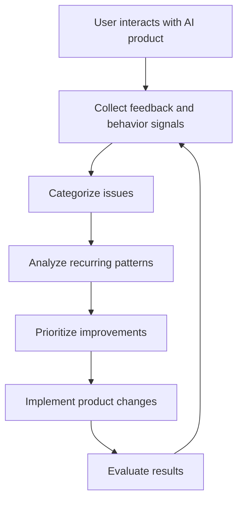

# Designing AI Feedback and Error Recovery

## 1. Introduction

AI products are inherently probabilistic. Unlike conventional software that often follows predefined rules, AI systems generate predictions, recommendations, and responses based on learned patterns and available context.

As a result, AI products may produce:

- Incorrect or misleading answers.
- Incomplete or irrelevant responses.
- Unexpected outputs.
- Inconsistent results across repeated requests.
- Misunderstandings of user intent.
- Failures caused by unavailable tools or external services.

These situations create additional UX challenges. Users need to understand what the system is doing, recognize when something has gone wrong, and know how to continue.

Two capabilities are essential:

**Feedback design** communicates system behavior and allows users to respond to AI outputs.

**Error recovery design** helps users correct problems, retry tasks, change direction, or move to an alternative solution.

Effective feedback and recovery mechanisms improve usability, user confidence, and the overall reliability of AI-powered products.

## 2. Understanding Feedback in AI Products

Feedback is information exchanged between the user and the system during an interaction.

In AI products, feedback serves several purposes:

1. Communicating system status.
2. Confirming that user input has been received.
3. Explaining AI-generated results.
4. Helping users identify incorrect or incomplete outputs.
5. Allowing users to correct the system.
6. Collecting information for product improvement.

Feedback should be considered throughout the product experience rather than added only after an AI response is generated.

### 2.1 Three Types of Feedback

AI product feedback can be divided into three practical categories.

| Feedback type | Purpose | Example |
|---|---|---|
| System feedback | Communicates system state and activity | "Searching your documents..." |
| User-to-AI feedback | Allows users to correct or evaluate AI outputs | Thumbs up, thumbs down, or revised instructions |
| Product improvement feedback | Helps teams identify recurring problems | User surveys and categorized failure reports |

These categories are related but serve different purposes.

A loading indicator helps users understand system activity. A correction tells the AI what the user wants changed. A feedback report helps the product team identify broader quality issues.

### 2.2 Feedback Is More Than a Rating

A simple thumbs-up or thumbs-down interaction is easy to implement, but it provides limited diagnostic information.

For example, a negative rating does not explain whether the problem was:

- Factual inaccuracy.
- Missing information.
- Poor relevance.
- Unclear explanations.
- Incorrect tone.
- Unhelpful formatting.
- A failure to understand the request.

A useful feedback system should collect enough context to identify actionable problems without creating unnecessary effort for users.

## 3. Designing System Feedback

System feedback tells users what is happening during an interaction.

AI processing may involve several stages, including input interpretation, retrieval, model generation, and external tool execution.

Without appropriate feedback, users may believe the application is frozen or that their request has failed.

### 3.1 Acknowledge User Input

The system should provide immediate confirmation after receiving a request.

Examples:

- Display the submitted message.
- Show the uploaded file name.
- Confirm that a task has started.
- Indicate that an operation is waiting for approval.

This helps users distinguish successful submission from an unresponsive interface.

### 3.2 Communicate Processing Status

Long-running operations should provide meaningful progress information.

Examples:

| System activity | Suggested status message |
|---|---|
| Processing user input | Understanding your request |
| Retrieving information | Searching available sources |
| Analyzing documents | Analyzing the uploaded content |
| Generating a response | Preparing your answer |
| Executing a tool | Updating your calendar |
| Waiting for approval | Waiting for your confirmation |

Status messages should reflect actual system activity.

Avoid displaying a specific operation as completed while it is still running.

### 3.3 Show Meaningful Progress

A generic loading spinner may be sufficient for short operations.

For longer tasks, consider displaying:

- The current processing stage.
- Completed steps.
- Pending actions.
- Relevant progress indicators.
- Estimated completion time when it can be reliably calculated.

Do not display fabricated percentage values or countdowns.

### 3.4 Communicate Completion

When a task finishes, clearly indicate the result.

Examples:

- "Your summary is ready."
- "The document was generated successfully."
- "Your appointment has been booked."
- "The search returned no matching results."

Completion feedback should distinguish between successful execution, partial completion, and failure.

## 4. Designing User-to-AI Feedback

Users need ways to communicate whether AI outputs meet their expectations.

A good feedback mechanism should be easy to discover, simple to use, and relevant to the task.

### 4.1 Explicit Feedback

Explicit feedback requires users to take a deliberate action.

Common examples include:

- Thumbs up and thumbs down.
- Star ratings.
- Written comments.
- Multiple-choice feedback categories.
- Correction suggestions.
- Report buttons.

Example:

After an AI-generated response, display:

**Was this answer helpful?**

- Yes
- No

If the user selects No, offer optional reasons:

- Incorrect information
- Missing details
- Irrelevant response
- Difficult to understand
- Other

This approach keeps the initial interaction simple while allowing users to provide more detail when needed.

### 4.2 Implicit Feedback

Implicit feedback is inferred from user behavior rather than explicitly submitted.

Possible signals include:

- Repeatedly regenerating a response.
- Editing generated content.
- Abandoning a task.
- Rephrasing the same question.
- Rejecting a recommendation.
- Switching to another feature.

These signals can help teams identify potential usability or quality problems.

However, implicit signals should be interpreted carefully.

For example, regenerating a response does not necessarily mean the previous response was incorrect. The user may simply want a different writing style.

Behavioral data should not automatically be treated as proof of user dissatisfaction.

### 4.3 Contextual Feedback

Feedback should be collected in the context of the task or output being evaluated.

For example:

- Ask users to rate an AI-generated summary immediately after displaying it.
- Allow users to report an incorrect search result next to that result.
- Provide correction controls beside a generated paragraph.
- Collect feedback after a completed workflow.

Contextual feedback reduces the effort required to explain what went wrong.

### 4.4 Progressive Feedback Collection

Do not require users to complete lengthy surveys after every interaction.

A practical approach is:

1. Provide a lightweight feedback option.
2. Offer optional reasons when users report a problem.
3. Allow additional comments when necessary.
4. Collect detailed feedback only for specific research or evaluation activities.

The feedback mechanism should not interrupt the primary task unnecessarily.

## 5. Designing AI Error States

AI error states occur when a system cannot produce an appropriate result or complete an operation.

Unlike traditional software errors, AI product failures may involve both technical problems and content-quality problems.

A useful error design distinguishes between different failure types.

### 5.1 Common AI Error Categories

| Error category | Description | Example |
|---|---|---|
| Input error | User input is missing or invalid | Unsupported file format |
| Intent error | System misunderstands the request | Incorrect task interpretation |
| Knowledge error | Required information is unavailable | No relevant source found |
| Generation error | AI produces an unsuitable response | Irrelevant or incomplete answer |
| Retrieval error | Relevant information is not retrieved | Missing document passages |
| Tool error | An external tool fails | Calendar API unavailable |
| Permission error | User lacks required authorization | Access denied |
| Network error | Connectivity or service communication fails | Request timeout |
| Safety restriction | Request cannot be fulfilled safely | Disallowed operation |
| Execution error | An intended action is not completed | Failed file upload |

These categories help product teams design more useful error messages and identify where failures occur.

### 5.2 Distinguish Content Errors from Technical Errors

An incorrect AI answer is different from a failed API request.

For example:

**Content-quality problem:**

"The explanation may be incomplete. Would you like to see another example?"

**Technical problem:**

"We couldn't retrieve the document. Check your connection and try again."

The first requires content correction or alternative reasoning. The second requires technical recovery.

Treating both situations as generic errors makes the product difficult to understand.

### 5.3 Use Clear Error Messages

A useful error message should answer three questions:

1. What happened?
2. What does it mean for the current task?
3. What can the user do next?

Example:

**Problem:** The uploaded file could not be processed.

**Explanation:** This file format is not supported.

**Recovery:** Upload a PDF, DOCX, or TXT file instead.

Avoid exposing raw stack traces, API responses, or internal technical identifiers to ordinary users.

These details can be recorded in internal logs for troubleshooting.

### 5.4 Communicate Uncertainty Without Creating Confusion

AI systems may produce answers with incomplete evidence or ambiguous interpretations.

Instead of presenting uncertain information as verified fact, communicate limitations appropriately.

Examples:

- "I couldn't find enough information to answer confidently."
- "This is one possible interpretation of your request."
- "The available sources do not confirm this detail."
- "Please verify this information before taking action."

Uncertainty messages should be specific and proportionate. Repeated generic disclaimers can reduce usability without helping users make better decisions.

## 6. Designing Error Recovery

Error recovery describes how users and systems return to a useful state after a failure or unexpected result.

A well-designed recovery process minimizes repeated work and prevents users from losing important information.

### 6.1 Retry

Retry allows users to submit the same operation again.

It is useful for temporary problems such as network interruptions or service timeouts.

However, retry should not be the only recovery option.

Repeatedly submitting an identical request will not necessarily fix an incorrect AI interpretation or an unsupported input.

### 6.2 Edit and Resubmit

When the problem is related to user input or intent, allow users to modify the original request.

Example:

**User:** Compare these two products.

**AI:** Which products would you like to compare?

**User:** I mean Product A and Product B.

**AI:** Understood. Here is the comparison.

Editing and resubmission should preserve the relevant context whenever possible.

### 6.3 Regenerate

Regeneration allows users to request another AI-generated result.

It can be useful when:

- The answer is incomplete.
- The response format is unsuitable.
- The user wants another explanation.
- The generated content does not meet the expected requirements.

However, regeneration is not a reliable correction mechanism for factual errors.

A new response may still contain incorrect information.

For factual or high-impact content, provide additional verification or source-based correction mechanisms.

### 6.4 Undo and Revert

Undo allows users to reverse a supported action.

Examples:

- Restore previously edited content.
- Revert a document change.
- Remove an applied recommendation.
- Restore an earlier version of generated content.

For irreversible operations, such as sending a message or submitting a payment, an ordinary Undo control may not be possible.

The product should communicate action consequences before execution.

### 6.5 Alternative Solutions

When the original task cannot be completed, offer another path.

Examples:

- Use a different file format.
- Search another information source.
- Complete the task manually.
- Select a different option.
- Contact human support.

Alternative solutions help users continue without repeatedly attempting an unsupported operation.

### 6.6 Human Escalation

Some problems require human judgment or specialized support.

Provide escalation when:

- The issue cannot be resolved automatically.
- The task has significant consequences.
- The user disputes an important result.
- The system encounters repeated failures.
- The task requires authorization or professional expertise.

A handoff should communicate whether the request has actually been transferred and what information will be shared.

## 7. Designing Recovery by Failure Type

Different errors require different recovery strategies.

| Failure | Recommended recovery |
|---|---|
| Temporary network failure | Retry and preserve user input |
| Invalid input | Explain the requirement and allow editing |
| Ambiguous request | Ask a focused clarification question |
| Irrelevant response | Allow correction or prompt refinement |
| Missing source information | Suggest another source or explain the limitation |
| Tool execution failure | Show execution status and offer a safe retry |
| Permission failure | Explain required access and provide an authorization path |
| Unsupported operation | Explain the limitation and offer alternatives |
| High-impact disagreement | Provide evidence, review, or human escalation |

The recovery mechanism should match the cause of failure rather than rely on a single generic retry button.

## 8. Preventing Duplicate and Unsafe Actions

Recovery mechanisms introduce an important risk: users may repeat an action that has already succeeded.

For example, a user may retry a payment request after a timeout even though the original payment was completed.

This can result in duplicate transactions.

### 8.1 Verify Execution Status

Before allowing a consequential operation to be repeated, the system should check whether the original operation succeeded.

Possible states include:

- Not started
- Pending
- In progress
- Completed
- Failed
- Outcome unknown

An unknown outcome should not automatically be treated as failure.

### 8.2 Use Safe Retry Mechanisms

For external operations, engineering teams may use idempotency keys or other duplicate-prevention mechanisms.

An idempotent operation can be safely repeated without producing unintended duplicate effects, subject to the operation's implementation.

From a UX perspective:

- Show whether the original request is still processing.
- Disable duplicate submission when appropriate.
- Explain when the execution result is uncertain.
- Provide a way to verify the operation.
- Avoid encouraging repeated actions until the status is known.

### 8.3 Protect Important User Data

If an operation fails, preserve the information users have already entered whenever possible.

For example:

- Keep the original message.
- Retain uploaded file selections.
- Preserve form values.
- Maintain the current task context.
- Avoid clearing completed work without warning.

Data preservation is one of the most practical ways to reduce the frustration caused by errors.

## 9. Designing a Feedback-to-Improvement Loop

Collecting feedback is only useful when product teams analyze it and take appropriate action.

A feedback-to-improvement loop connects user experiences with product decisions.

### 9.1 The Improvement Cycle

A practical cycle includes six stages:

1. Collect feedback.
2. Categorize problems.
3. Analyze recurring patterns.
4. Prioritize improvements.
5. Implement changes.
6. Evaluate the results.

Example:

### 9.2 Categorize Feedback

Useful categories include:

- Accuracy
- Relevance
- Completeness
- Clarity
- Response speed
- Interaction difficulty
- Context understanding
- Tool execution
- Trust and transparency
- Privacy concerns

A consistent taxonomy makes feedback easier to analyze across product features and releases.

### 9.3 Prioritize Problems

Not every negative comment requires an immediate product change.

Consider:

- Frequency: How often does the problem occur?
- Severity: How much does it affect users?
- Impact: How many users or workflows are affected?
- Risk: Could the problem cause harm or significant loss?
- Feasibility: How difficult is it to address?

High-severity safety or security issues may require immediate action even when they are reported infrequently.

### 9.4 Close the Feedback Loop

When appropriate, tell users that their feedback has been received and explain what happens next.

Examples:

- "Thanks. Your feedback has been submitted."
- "This issue has been reported to the support team."
- "Your correction has been applied to this response."

Do not claim that feedback has changed the model or product unless that change has actually occurred.

A user correction during a conversation does not necessarily update the underlying AI model.

## 10. Measuring Feedback and Recovery Effectiveness

Product teams need measurable indicators to understand whether feedback and recovery mechanisms are working.

### 10.1 Feedback Metrics

| Metric | What it measures |
|---|---|
| Feedback submission rate | Percentage of eligible interactions that receive feedback |
| Positive feedback rate | Share of submitted positive ratings |
| Negative feedback rate | Share of submitted negative ratings |
| Feedback category distribution | Most frequently reported problem types |
| Comment completion rate | Percentage of users who provide additional explanations |

A feedback rate should always be interpreted in context. Users who choose to submit feedback may not represent the entire user population.

### 10.2 Error Metrics

| Metric | What it measures |
|---|---|
| Error rate | Frequency of defined system failures |
| Task failure rate | Percentage of tasks that do not reach the intended outcome |
| Tool failure rate | Frequency of failed external tool operations |
| Timeout rate | Percentage of operations exceeding the defined time limit |
| Duplicate action rate | Frequency of unintended repeated operations |

Each metric requires a clearly defined denominator, event scope, and measurement period.

### 10.3 Recovery Metrics

| Metric | What it measures |
|---|---|
| Recovery success rate | Percentage of failed tasks that successfully recover |
| Retry success rate | Percentage of retries that resolve the original problem |
| Average recovery time | Time required to return to a usable state |
| Abandonment after error | Percentage of users who leave after an error |
| Human escalation rate | Percentage of cases transferred to human support |

For example:

$$
\text{Recovery Success Rate} =
\frac{\text{Successfully Recovered Tasks}}
{\text{Tasks Entering Recovery}}
\times 100\%
$$

Metrics should be segmented by error type, feature, user group, and task complexity where appropriate.

A high retry rate does not necessarily indicate good recovery. Users may be repeatedly attempting the same unsuccessful operation.

## 11. Practical Example: Improving an AI Learning Assistant

Consider an AI learning assistant that explains mathematics and generates practice questions.

Students may encounter several problems:

- The explanation is too difficult.
- The answer contains an incorrect calculation.
- The AI misunderstands the submitted question.
- The student does not understand the feedback.
- The system fails to generate another exercise.

### 11.1 Design Feedback Controls

After each explanation, provide simple options:

- Helpful
- Not helpful
- Explain more simply
- Show another example
- Check the calculation

These options allow students to express specific needs without writing lengthy feedback.

### 11.2 Design Error Recovery

| Problem | User-facing response | Recovery |
|---|---|---|
| Explanation too difficult | "Would you like a simpler explanation?" | Generate a simpler version |
| Incorrect calculation reported | "Let's check the calculation again." | Recalculate and explain |
| Question unclear | "I need one more detail about the question." | Request clarification |
| Exercise generation fails | "I couldn't generate a new question right now." | Retry or return to existing exercises |
| Student gives an incorrect answer | "That answer is not quite right. Let's review the next step." | Provide a hint |

### 11.3 Design a Feedback Loop

Suppose students frequently report that explanations are too difficult.

The product team can:

1. Categorize the feedback as explanation complexity.
2. Review the affected topics and user interactions.
3. Determine whether the issue is related to language, mathematical knowledge, or explanation structure.
4. Improve explanation templates or generation instructions.
5. Test the updated experience with students.
6. Compare feedback and learning outcomes before and after the change.

This approach connects individual user experiences with systematic product improvement.

### 11.4 Evaluate the Improvements

Possible evaluation questions include:

- Can students easily request simpler explanations?
- Can they identify how to report incorrect calculations?
- Do they understand recovery instructions?
- Can they continue learning after a failed interaction?
- Do improved explanations help students solve similar problems independently?

The goal is not simply to reduce negative feedback. It is to improve the quality and usefulness of the learning experience.

## 12. Common Feedback and Error Recovery Design Mistakes

| Mistake | Why it is a problem | Better approach |
|---|---|---|
| Collecting only thumbs-up and thumbs-down | Provides limited diagnostic information | Offer optional feedback categories |
| Displaying generic error messages | Users do not know what happened | Explain the problem and next step |
| Using Retry for every failure | Does not address incorrect input or intent | Match recovery to the failure type |
| Losing user input after failure | Forces users to repeat work | Preserve input and task context |
| Showing misleading progress | Creates false expectations | Display only meaningful system states |
| Treating regeneration as fact checking | New outputs may repeat errors | Support evidence-based verification |
| Retrying external actions blindly | May cause duplicate operations | Verify execution status first |
| Collecting feedback without analysis | Produces data without improvement | Establish an analysis and prioritization process |
| Claiming feedback changed the model | Creates false expectations | Explain what feedback actually does |
| Making recovery difficult to discover | Users may abandon the task | Place relevant controls near the problem |

## 13. Feedback and Error Recovery Design Checklist

### System Feedback

- [ ] Does the interface acknowledge user input?
- [ ] Are long-running operations accompanied by meaningful status updates?
- [ ] Are processing, approval, completion, and failure states distinguishable?
- [ ] Are progress indicators based on actual system information?
- [ ] Are completed actions confirmed only after successful execution?

### User Feedback

- [ ] Can users rate AI-generated results?
- [ ] Can users report specific problems?
- [ ] Are feedback controls easy to discover?
- [ ] Is additional feedback optional when possible?
- [ ] Is feedback collected in the context of the relevant interaction?

### Error Handling

- [ ] Are common AI and technical failures identified?
- [ ] Are content-quality errors distinguished from technical errors?
- [ ] Are error messages clear and actionable?
- [ ] Are limitations and uncertainty communicated appropriately?
- [ ] Are sensitive errors handled with suitable safeguards?

### Error Recovery

- [ ] Can users retry appropriate operations?
- [ ] Can users edit and resubmit requests?
- [ ] Can users regenerate or revise outputs?
- [ ] Are supported undo and cancellation controls available?
- [ ] Is user input preserved after failure?
- [ ] Are duplicate external actions prevented?
- [ ] Can users escalate unresolved issues?

### Product Improvement

- [ ] Is feedback categorized consistently?
- [ ] Are recurring issues analyzed?
- [ ] Are improvements prioritized by impact and risk?
- [ ] Are changes evaluated after implementation?
- [ ] Is the feedback loop connected to product development?

## 14. Conclusion

Feedback and error recovery are essential parts of AI product UX.

Because AI systems can misunderstand requests, generate unsuitable outputs, or depend on unreliable external services, users need more than a response interface. They need clear system feedback, meaningful correction mechanisms, and reliable ways to recover from failures.

Product teams should design these mechanisms as part of the complete user journey.

By collecting actionable feedback, distinguishing different failure types, preserving user work, and measuring recovery outcomes, teams can create AI products that are easier to use and continuously improve.

## Further Reading

- [People + AI Guidebook – Google PAIR](https://pair.withgoogle.com/guidebook/)
- [Human-AI Interaction Guidelines – Microsoft Research](https://www.microsoft.com/en-us/research/project/guidelines-for-human-ai-interaction/)
- [Nielsen Norman Group – Error Message Guidelines](https://www.nngroup.com/articles/error-message-guidelines/)
- [Nielsen Norman Group – Error Prevention](https://www.nngroup.com/articles/slips/)
- [Google SRE Book – Handling Overload](https://sre.google/sre-book/handling-overload/)
